# Zuki Nav

**Google Maps turn-by-turn on your Suzuki's dash.** If your bike or scooter
has **Suzuki Ride Connect**, Zuki Nav puts the next turn, the distance to it
and your arrival time on the dash, straight from the Google Maps you already
use. Along the way it keeps a diary of every ride, watches your engine
temperature, learns your real fuel range and handles calls so you don't have
to touch the phone.

Free, open source, no account, no ads. Everything stays on your phone.

**Website:** [th4rv4.github.io/Zuki_Nav](https://th4rv4.github.io/Zuki_Nav/) ·
**Download:** [latest release](https://github.com/th4rv4/Zuki_Nav/releases/latest)

Unofficial and not affiliated with Suzuki. Use at your own risk, and don't
fiddle with your phone while riding.

## Screenshots

Real screens from a phone connected to a Gixxer SF 250. Every number came from the bike's own dash.

<table>
  <tr>
    <td align="center" valign="top">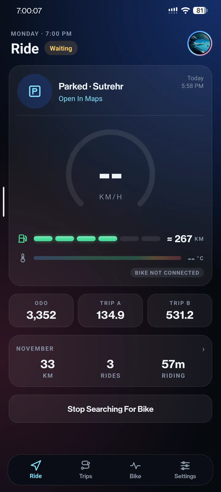<br><sub><b>Ride</b></sub></td>
    <td align="center" valign="top">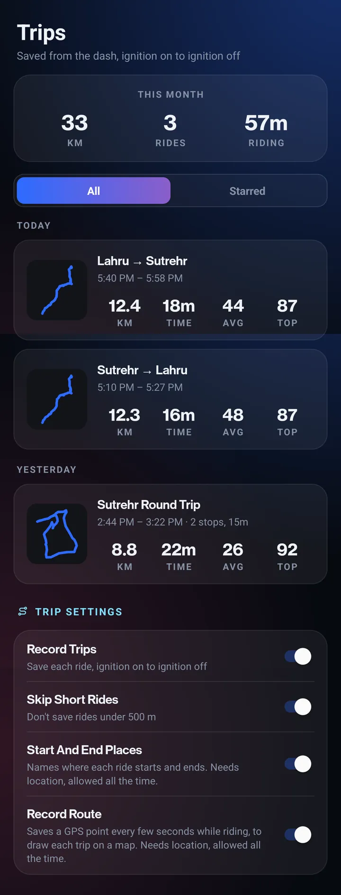<br><sub><b>Trips</b></sub></td>
    <td align="center" valign="top">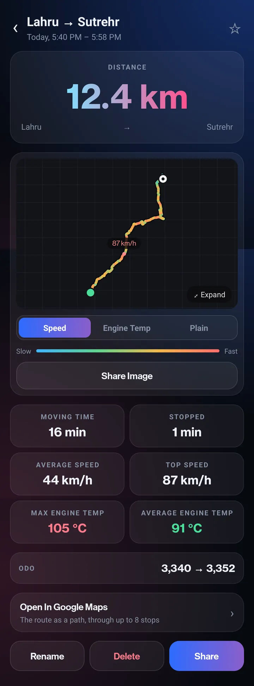<br><sub><b>A Trip</b></sub></td>
    <td align="center" valign="top">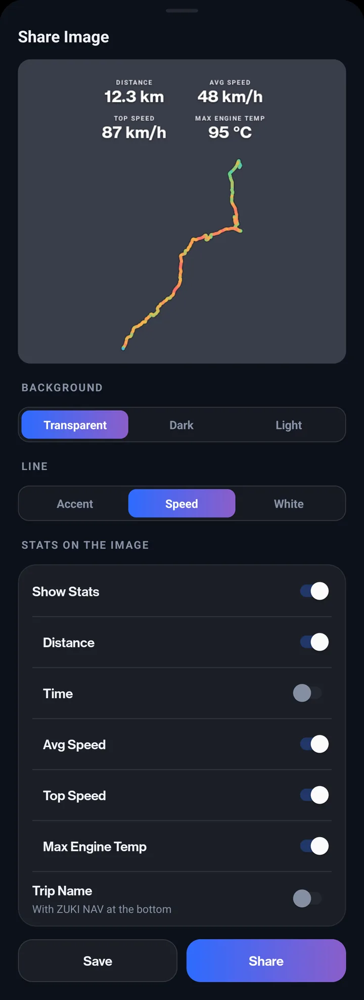<br><sub><b>Share Image</b></sub></td>
  </tr>
  <tr>
    <td align="center" valign="top">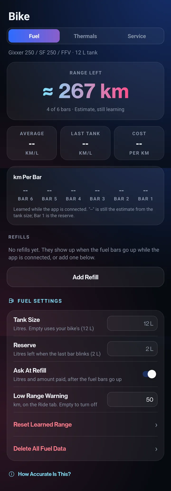<br><sub><b>Fuel</b></sub></td>
    <td align="center" valign="top">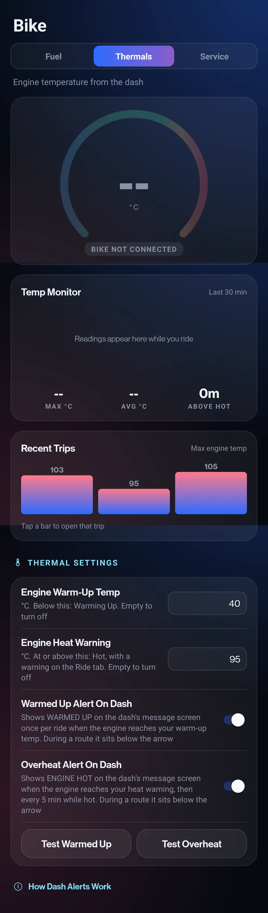<br><sub><b>Thermals</b></sub></td>
    <td align="center" valign="top">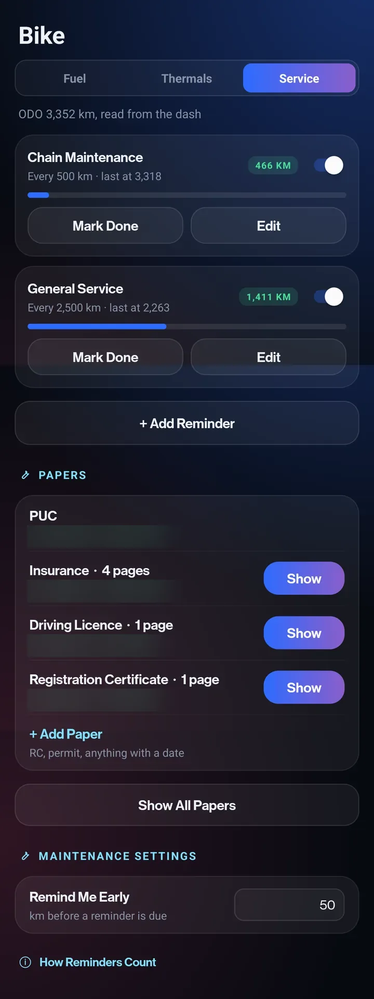<br><sub><b>Service</b></sub></td>
    <td align="center" valign="top">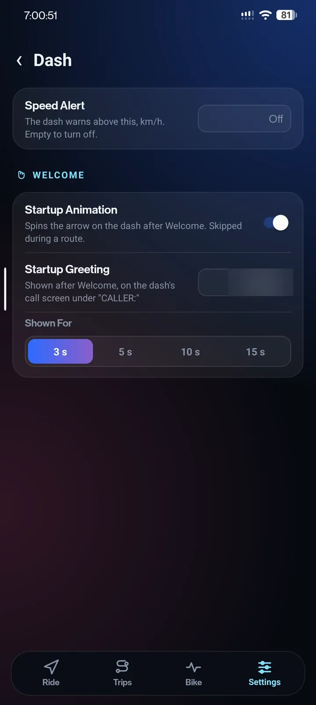<br><sub><b>Dash</b></sub></td>
  </tr>
  <tr>
    <td align="center" valign="top">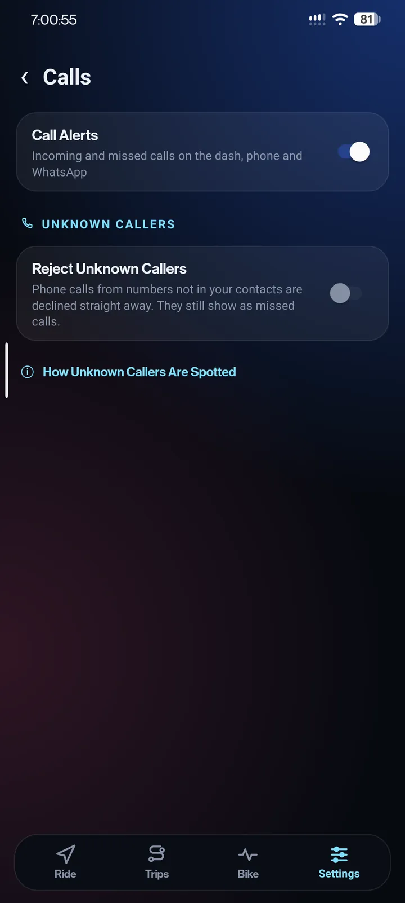<br><sub><b>Calls</b></sub></td>
    <td align="center" valign="top">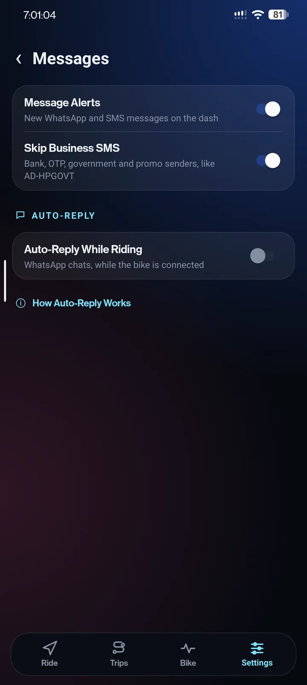<br><sub><b>Messages</b></sub></td>
    <td align="center" valign="top">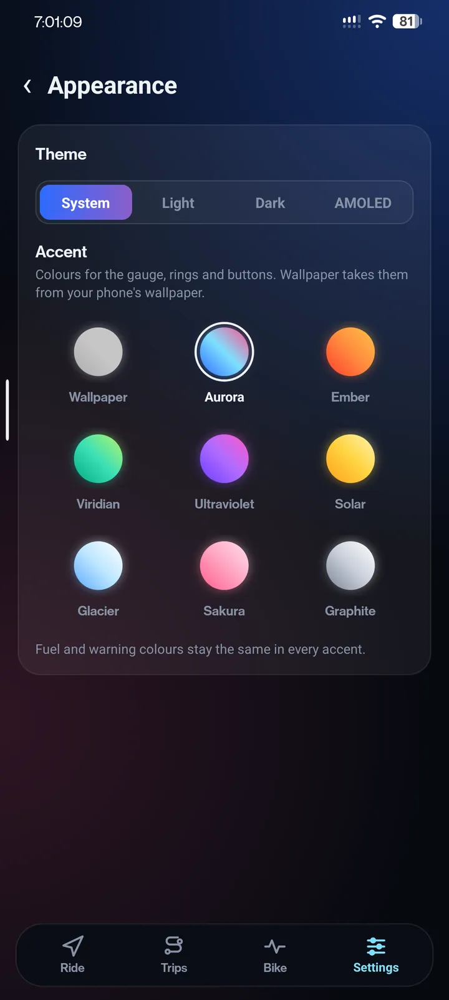<br><sub><b>Appearance</b></sub></td>
    <td align="center" valign="top">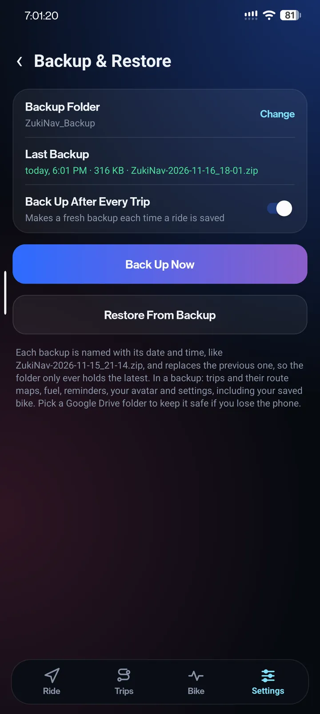<br><sub><b>Backup</b></sub></td>
  </tr>
</table>

### On the bike

<table>
  <tr>
    <td align="center" valign="top">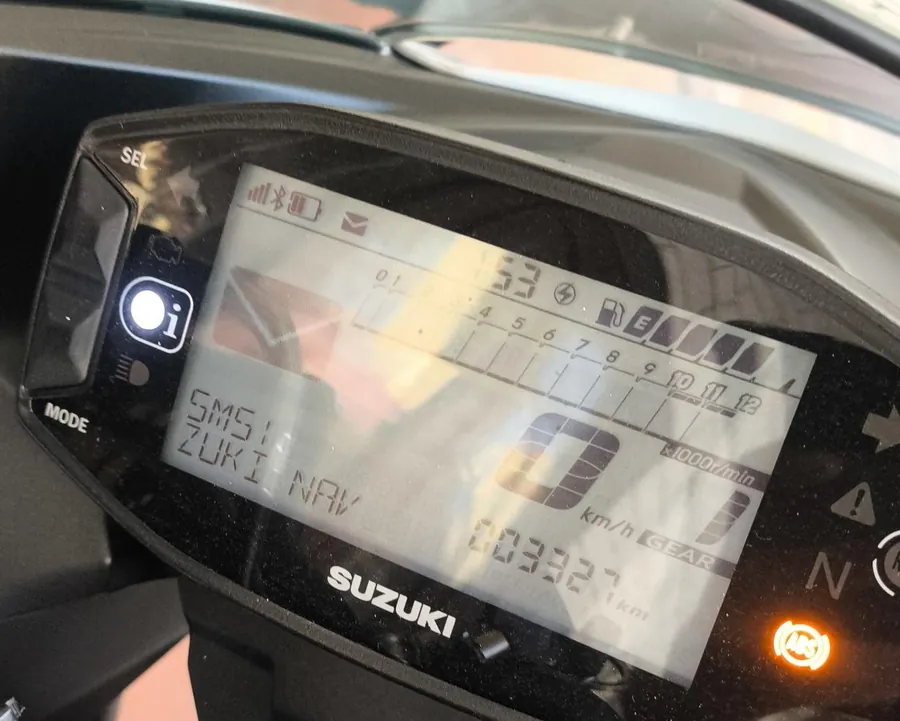<br><sub><b>A message, without picking up the phone</b></sub></td>
    <td align="center" valign="top">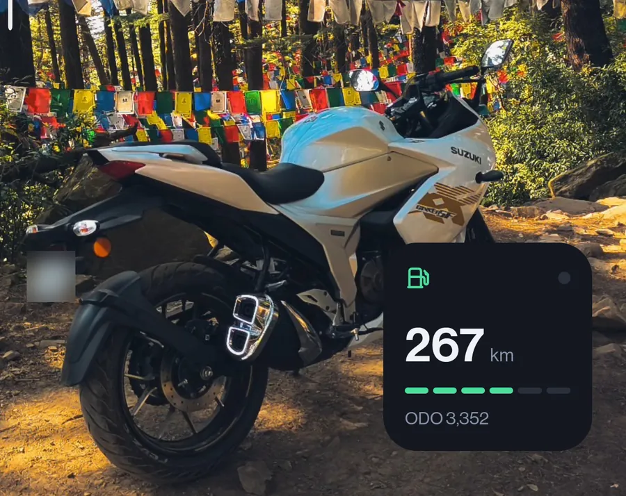<br><sub><b>Range, fuel and ODO on your home screen</b></sub></td>
  </tr>
</table>

## Here's what we do differently

- **The Maps you already use.** Real Google Maps guidance on the dash, with
  its live traffic, reroutes and your saved places. Nothing new to learn.
- **Every Ride Connect model.** Gixxer, Gixxer 250, V-Strom SX, Access,
  Burgman Street and Avenis, and also the TFT editions and the e-ACCESS.
- **Trips that understand a day out.** A chai break or a fuel stop doesn't
  chop your ride into pieces. With a Maps route open, your ride stays one
  ride even through a long lunch. Stops are listed with where and how long,
  and a long jam is told apart from a red light.
- **Your ride as a poster.** Every ride's route turns into a Strava-style
  map doodle, coloured by speed, with your distance, speeds and engine
  temperature on it. Make it see-through to drop over your own photo, then
  share it to Instagram or WhatsApp or save it, in one tap.
- **Distance from the bike itself.** Trip distance comes from your bike's own
  trip meter, so it matches the dash, not a phone GPS guess.
- **Engine temperature you can act on.** The dash sends it but nothing showed
  it. Zuki Nav shows it live, keeps a 30-minute graph, and can flash
  **WARMED UP** and **ENGINE HOT** on the dash.
- **Calls handled for you.** Unknown numbers can be declined while you ride
  (a second call from the same number still rings through), WhatsApp chats
  can get an automatic "riding, will call back" reply, and bank and OTP
  SMS can be kept off the dash.
- **Range that learns your bike.** It works out how many km you really get
  from each fuel bar, so the range left gets better with every tank.
- **Easy on the battery.** Between turns the phone is left to sleep, GPS
  shares what Google Maps already gets, and with **Wake On Ignition** the
  app doesn't even run while the bike is parked.
- **Updates inside the app**, and a **backup after every ride** to your own
  Google Drive or Downloads folder.

## On the ride

- **Turn arrows on the dash**: the arrow, the distance to the turn, your
  ETA and the distance left, kept up to date several times a second.
- **Calls**: incoming, answered and missed calls (phone and WhatsApp) with
  the caller's name, as saved in your contacts.
- **Messages**: new WhatsApp messages and SMS with the sender's name and how
  many are unread. **Skip Business SMS** keeps bank, OTP and promo
  messages off the dash.
- **Reject Unknown Callers** (optional): declines calls from numbers not in
  your contacts, only while riding or always. **Allow Repeat Callers** lets a
  second call within 5 minutes ring through, in case it's urgent. The dash can
  show **REJECTED** so you know it happened.
- **Auto-Reply** (optional): answers WhatsApp chats with your own message
  while you ride. Choose contacts only, and how often the same chat gets a
  reply (every 15 or 30 minutes, or once per ride). Group chats are skipped.
- **Greeting**: the dash welcomes you by name when you switch on, with an
  optional spin of the compass needle.
- **Speed Alert**: sets the dash's own speed warning.
- **Engine alerts**: **WARMED UP** once the engine reaches your warm-up
  temperature, and **ENGINE HOT** when it reaches your limit, again every
  5 minutes while it stays hot.
- **The Ride tab**: a live copy of your dash on the phone, with the next
  turn, speed, fuel, engine temperature, ODO and both trip meters, the ride
  in progress and this month's totals.

## After the ride

- **Trips**: every ride is saved with its distance, riding and stationary
  time, average and top speed, engine temperature and the ODO at start and
  end. Rename, star, share or delete them.
- **How rides are split** (in plain words):
  - The ride goes on as long as the bike is switched on, even standing
    still.
  - Switch off for under 10 minutes and you're still on the same ride; the
    break shows as a stop.
  - With a Google Maps route open, the ride waits up to 2 hours, so a long
    lunch on a trip stays one ride. Reaching your destination or closing the
    route brings back the 10 minutes.
  - Switched off for 2 minutes or more, or standing still for 5 minutes or
    more (a long jam), counts as a **stop**. Red lights are just stationary
    time.
  - While the bike is off, the Current Ride card shows when the ride will end
    by itself, and an **End Ride** button if you're done early (with Undo).
- **Stops**: a timeline of each part of the ride and each stop, marked on
  the map. Label them Fuel, Chai Break, Food, Photos and so on.
- **Route maps** (optional): your path drawn on a map, coloured by speed or
  engine temperature, with the start, end and top speed marked. Works offline.
- **Share Image**: turns any ride into a ready-to-post route doodle.

  <table>
    <tr>
      <td align="center" valign="top">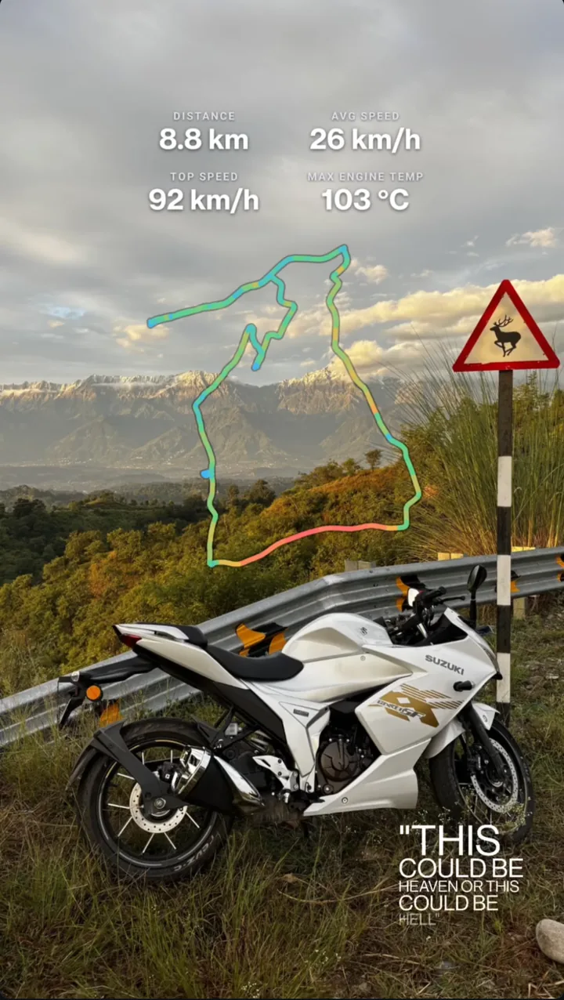<br><sub><b>Transparent, over a photo from the ride</b></sub></td>
      <td align="center" valign="top">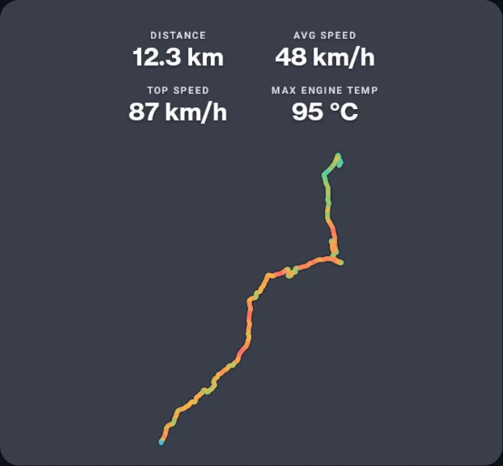<br><sub><b>The image as the app makes it</b></sub></td>
    </tr>
  </table>

  - **Background**: Transparent (a sticker for your own photo or story),
    Dark or Light.
  - **Line**: your accent colour, coloured by speed, or plain white.
  - **Stats**: pick any of Distance, Time, Avg Speed, Top Speed and Max
    Engine Temp, and add the trip name.
  - **Share** straight to Instagram, WhatsApp and the like, or **Save** it to
    your gallery. Your choices are remembered for next time.
- **Month Recap**: at the start of each month, a card with last month's
  km, rides and riding time, ready to share.
- **Merge With Next Ride**: joins two rides into one if you ever need to.
- **Parked Spot**: where the bike was switched off, with walking directions
  back to it.

## Your bike

- **Fuel**: Zuki Nav notices a refill when the fuel bars go up and asks for
  the litres and amount paid (both optional). It works out mileage and cost
  per km, and the range left from what each bar really gives you.
- **Thermals**: the engine temperature on a cold-to-hot gauge, a graph of
  the last 30 minutes, and each ride's highest and average temperature.
- **Service**: reminders for chain maintenance, general service and your own
  jobs, every so many km, months, or both, counted from the bike's ODO.
  A notification comes when one is close and when it's due.
- **Papers**: keep your PUC, insurance and driving licence (and any other
  paper) with photos or PDFs, and get a reminder 15 days before one
  expires and on the day.
- **Home screen widget**: a small square showing range, fuel bars and ODO,
  and whether the bike is connected.

## Setting up

1. Install the APK from the [latest release](https://github.com/th4rv4/Zuki_Nav/releases/latest).
2. Open Zuki Nav. The setup screen walks you through:
   - **Nearby Devices** and **Notification Access** (this is how it reads
     Google Maps, calls and messages; no other permission is needed for them).
   - **Contacts** (optional): shows callers with the name you saved them
     under, not the name their SIM is registered to. Read on the phone only.
   - **Close Suzuki Ride Connect**: the dash talks to one app at a time.
   - **Your Name** for the greeting (optional).
3. Switch the ignition on, pick your bike from the list and tap **Finish Setup**.
4. Start a route in Google Maps and ride.

Tips:
- **Wake On Ignition** (Settings, Android 12 and newer) lets Android wake
  Zuki Nav when you switch on, so nothing runs while you're parked.
- Trips with start and end places, routes and parked spot need location
  allowed **all the time**, because the ride ends with the phone in your pocket.
- If the dash shows nothing, check that the bike isn't paired in your
  phone's Bluetooth settings; the Ride tab tells you if it is.

## Settings at a glance

- **Dash**: speed alert, startup animation, greeting and how long it shows.
- **Calls** and **Messages**: what reaches the dash, Reject Unknown Callers,
  Auto-Reply.
- **Appearance**: System, Light, Dark or AMOLED, and an accent colour (or
  your wallpaper's colours on Android 12 and newer).
- **Backup & Restore**: one zip with everything, in a folder you choose,
  optionally after every ride. Restoring checks the file first and changes
  nothing if it's damaged.
- **Updates**: checks this page for a new version and installs it, if you
  allow it to. That's the only time the app goes online, apart from place
  names for your trips.
- **Troubleshooting**: Dash Test (try every turn icon on your dash), what's
  being sent, and the log to share when reporting a problem.

## For the technically curious

Suzuki Ride Connect only navigates with Mappls. Zuki Nav reads the guidance
notification Google Maps already shows and sends it to the cluster over
Bluetooth LE, using the cluster's own protocol (see
[docs/PROTOCOL.md](docs/PROTOCOL.md)). It was built from the Indian Suzuki
Ride Connect app and defaults to left-hand traffic. Suzuki bikes sold outside
India use other connectivity systems and are not supported.

### Supported models

Every vehicle Suzuki Ride Connect 8.0 can pair with. The model is detected
from the cluster's Bluetooth name (`S` + family letter + model code, e.g.
`SBM21…`).

| Model | Type | Name code | Family |
|---|---|---|---|
| Gixxer / Gixxer SF | Motorcycle | `BM11` | B |
| Gixxer 250 / SF 250 / FFV | Motorcycle | `BM21`, `BM22` | B |
| V-Strom SX | Motorcycle | `BM01` | B |
| Access 125 | Scooter | `AS01`, `AS02` | A |
| Access | Scooter | `AS21`, `BS4x` | A / B |
| Access TFT Edition | Scooter | `CS0x` | C |
| e-ACCESS | Scooter | `CEx` | C |
| Burgman Street | Scooter | `AS11`, `AS12`, `BS11`, `BS12`, `BS51` | A / B |
| Burgman Street EX | Scooter | `BS31`, `BS32` | B |
| Burgman Street TFT Edition | Scooter | `CS1x` | C |
| Avenis | Scooter | `BS21`, `BS22` | B |

What changes between models, all taken from the Suzuki app:

- **Family A** uses a different checksum and a status frame without weather.
- **Family C** (TFT) shows the ETA without a leading zero and gets no status
  frame (the Suzuki app's own status frame for them is broken).
- **Access-type** clusters (Access, e-ACCESS, TFT editions, Burgman `BS51`)
  use other icon IDs for a left off-ramp and the first exit of a
  counter-clockwise roundabout.

An unknown code still works: the family letter picks the checksum and layout.

Status: frame bytes are verified against the Suzuki app's own code for every
model above, but no model has been tested on a real bike yet. The author's
own bike is a Gixxer SF 250. Reports from other models are welcome,
especially results from **Icon Test → Cycle All**.

### How the turn arrow is chosen

1. **The Maps arrow itself.** Google Maps ships its arrows as named drawables
   (`maneuver_turn_sharp_left`, `maneuver_roundabout_enter_and_exit_cw_slight_right`, …).
   On first use the app renders those from the installed Maps app and
   fingerprints their shapes. Each notification arrow is matched to the
   nearest one. No Google artwork is bundled.
2. **The instruction text**, if Maps spells the maneuver out ("Sharp right",
   "take the 2nd exit"). English only.
3. **The previous arrow**, if neither gives an answer.

This approach, and the Maps notification layouts, follow
[KTM-Nav-GEN3](https://github.com/Pavanayi1/KTM-Nav-GEN3) (MIT).

### Turn icons

Run **Dash Test → Cycle All** once to check every icon on your dash.
Icons 1 to 46 have all been checked on a Gixxer SF 250. Icons 47 to 64
depend on the traffic side and the model: on a Gixxer SF 250, icon 46 is a
"!" and 47 to 64 are blank. The app sends the icon the Traffic Side setting
asks for either way.

### Build

GitHub Actions (`.github/workflows/build.yml`) builds when a version tag
is pushed, or when started by hand (Actions → Build → Run workflow). Plain
commits don't trigger it. Unit tests run and the APK is attached to the run
as an artifact.

Releases are signed with a private release key kept in the repo's Actions
secrets: `RELEASE_KEYSTORE_BASE64` (the `.jks` file, base64), `RELEASE_STORE_PASSWORD`,
`RELEASE_KEY_ALIAS` and `RELEASE_KEY_PASSWORD`. Without them the workflow
falls back to the debug APK, which Google Play Protect flags as harmful
because its key is public. Moving from a debug-signed build to the release
key needs one uninstall and reinstall, as Android only updates an app
signed with the same key.

A tag push also publishes a GitHub Release named after the tag, with the
APK attached and every commit since the previous `v*` tag listed in the
notes. The app's version name is taken from the tag (`v0.2.0` → `0.2.0`).

```
git tag v0.2.0
git push origin v0.2.0
```

To build locally:

```
./gradlew testDebugUnitTest assembleDebug
adb install -r app/build/outputs/apk/debug/app-debug.apk
```

Debug builds are signed with `app/debug.keystore` (password `android`), which
is checked in so that every build, local or CI, can update the previous one.
It is a public key: anyone can sign an APK with it, so only install builds
from this repo's releases.

Needs JDK 17+ and an Android SDK with platform 36 (`local.properties` → `sdk.dir`).
For a signed release, add `RELEASE_STORE_FILE`, `RELEASE_STORE_PASSWORD`,
`RELEASE_KEY_ALIAS` and `RELEASE_KEY_PASSWORD` to `local.properties` (or set
them as environment variables) and run `./gradlew assembleRelease`.

### Code layout

```
protocol/   frame builder, checksum, distance format, icon table, model table (pure Kotlin)
nav/        Maps notification parsing, arrow fingerprinting, listener
ble/        GATT client
service/    foreground service, boot receiver
trips/      ride and stop rules, route recording, trip storage
alerts/     calls, messages, Reject Unknown Callers, Auto-Reply
fuel/       refills, mileage and range
thermal/    engine temperature and its alerts
maint/      service reminders
papers/     PUC, insurance and licence with expiry reminders
backup/     Backup & Restore
update/     in-app updates from GitHub releases
widget/     home screen widget
ui/         screens (Ride, Trips, Dash Test, Settings, Setup), themes and shared components
```

## Support The Developer

Zuki Nav is free and open source, built in spare time on real rides. If it
made your trips better, you can support its development with a UPI tip:

**UPI ID: `atharvaagnihotri@upi`**

Paste it into GPay, PhonePe, Paytm or any UPI app, or use **Pay With UPI**
on the [website](https://th4rv4.github.io/Zuki_Nav/#support) or in the
app (Settings > About & Support) from your phone. Stars, bug reports and test results from other models help just as
much.

## License

MIT
